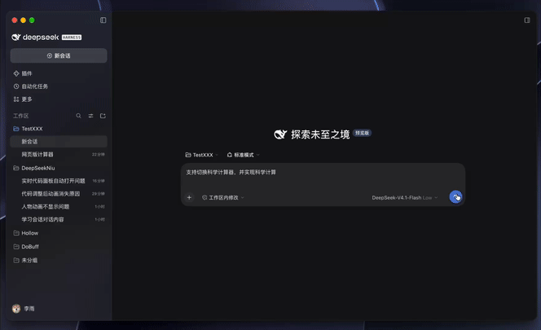

# LiveCode · 实时代码

English | [中文](README.zh.md)

**Watch the AI write the code.**

Most of the time an agent finishes, hands you a diff, and you read it after the
fact. LiveCode plays that moment instead — for the feeling of watching it happen,
the thing a finished diff never gives you.

It does not make the agent faster. It makes the process something you can watch,
and that is the point: a small, steady dose of "something is being built right
now" while you wait.

The invisible AI given a body: doing the emotional labour for you, and keeping
you company while you wait.



## Features

- **Watch the code being typed.** The change happens on the file's real text,
  line by line — not in a diff you read afterwards.
- **The AI, personified.**
- **Your character, your drink.** Switch between 大肥鱼 and 小绿, coffee and tea,
  and show or hide the scene, from the gear.

## Install

LiveCode is a DeepSeek Harness (DSH) bundle: no build step, no dependencies.

In DeepSeek: **Settings → Plugins → Add plugin**, and paste the repository
address:

```
https://github.com/liyu6969/LiveCode
```

(`github:liyu6969/LiveCode` works too.) Then enable **实时代码 / LiveCode** and ask
the agent to change a file — the panel opens on its own.

A local directory works the same way: paste its absolute path there, or from an
agent session run `plugin_manager install_bundle target=/absolute/path`. A local
directory is linked, so code changes reload in place; the repository address
installs a snapshot, which needs reinstalling to update.

> Typing just `LiveCode` does not work yet: that form is for a package published
> to npm, and this one is not published. Use the repository address or a local
> path.

## Use

The panel opens itself on the next `write` / `edit`. Click a tab to revisit a
file, `×` to close one, right-click for *close others* / *close all*. The gear in
the corner switches the character, the drink, and whether the scene shows at all.

## Settings

The gear popover remembers your choices. A profile can set defaults in
`cordis.patch.yml`:

```yaml
- id: dsh-code-live
  name: '@local/dsh-code-live'
  config:
    scene: true       # show the character
    sceneHeight: 168  # 120–280 px
    character: maid   # maid = 大肥鱼, mint = 小绿
    drink: coffee     # coffee | tea
```

## Development

```bash
node dev/render-probe.cjs          # headless render: empty / settled / streaming
OPEN=1 node dev/render-probe.cjs   # also render popovers and held frames
```

`HANDOFF.md` has the architecture and the decisions behind it.

## Contact me

WeChat — scan to add me:


X: [@liyust11](https://x.com/liyust11)

## License

MIT © 2026 liyu — see [LICENSE](LICENSE).
