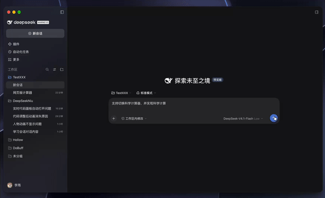

# LiveCode · 实时代码

[English](README.md) | 中文

**看着代码被 AI 写出来。**

平时 agent 改完文件，你只看到一个 diff，事情已经结束了。LiveCode 把那一小段时间演给你看，给自己带来更多情绪价值。

它不会让 agent 变快。它让等待的那段时间有东西可看——一种「现在正在被造出来」的确定感，这是它存在的理由。

把那个看不见的 AI 显化成一个人，正在帮你心情的劳作，也是一种等待的陪伴。



## 功能

- **实时展示代码被 AI 敲出来的效果。** 改动就发生在文件真实的文字上，一行行长出来，不是事后看一个 diff。
- **AI 人物显化。**
- **可配置的人物与饮品。** 齿轮里切换大肥鱼 / 小绿、咖啡 / 茶，以及是否显示场景。

## 安装

LiveCode 是一个 DeepSeek Harness（DSH）Web GUI 插件包，没有构建步骤、没有依赖。

在 DeepSeek 里：**设置 → 插件 → 添加插件**，把仓库地址贴进去：

```
https://github.com/liyu6969/LiveCode
```

（也接受 `github:liyu6969/LiveCode` 这种简写。）安装完成后启用 **实时代码 / LiveCode**，然后让 agent 改一个文件，面板会自己打开。

也可以装本地目录：同一处填目录的绝对路径，或者在 agent 会话里 `plugin_manager install_bundle target=/绝对路径`。
本地目录是链接安装，改完代码重新加载即可生效；从仓库地址安装拿到的是当时的快照，更新要重新安装。

> 直接输入 `LiveCode` 目前不行——这种写法是给已发布到 npm 的包用的，本插件还没有发布，请用上面的仓库地址或本地路径。

## 使用

下一次 `write` / `edit` 时面板会自己打开。点标签回看文件，`×` 关掉，右键可关闭其他/全部。右上角齿轮切换人物、饮品，以及是否显示这个场景。

## 设置

齿轮里的选择会被记住。profile 也可以在 `cordis.patch.yml` 里设默认值：

```yaml
- id: dsh-code-live
  name: '@local/dsh-code-live'
  config:
    scene: true       # 显示底部角色
    sceneHeight: 168  # 120–280 px
    character: maid   # maid = 大肥鱼，mint = 小绿
    drink: coffee     # coffee | tea
```

## 开发

```bash
node dev/render-probe.cjs          # 无头渲染：空页 / 已落定 / 流式中
OPEN=1 node dev/render-probe.cjs   # 连弹窗和停留帧一起渲染
```

架构、决策和踩过的坑在 `HANDOFF.md`。

## 联系我

微信：扫码加我


X：[liyust11](https://x.com/liyust11)

## 许可证

MIT © 2026 liyu，详见 [LICENSE](LICENSE)。
